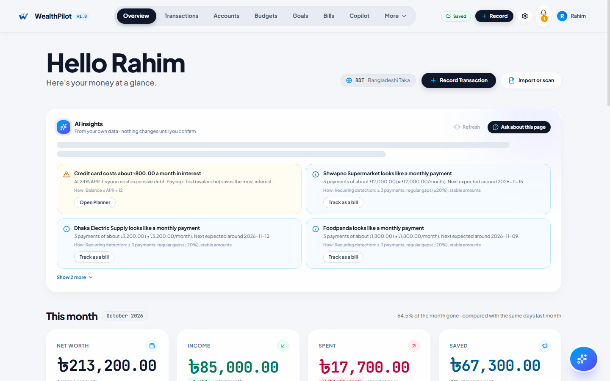
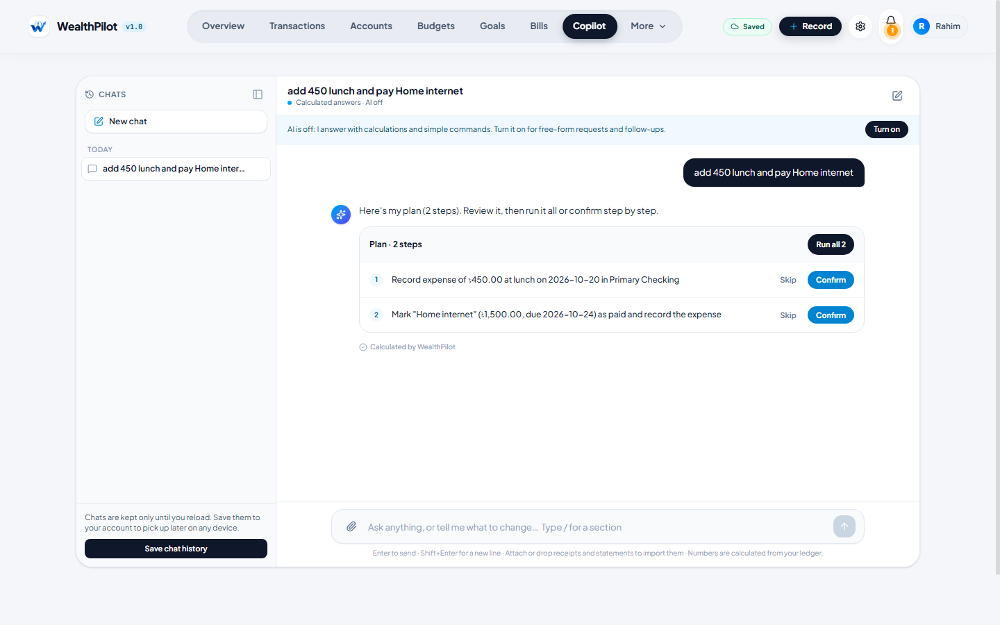
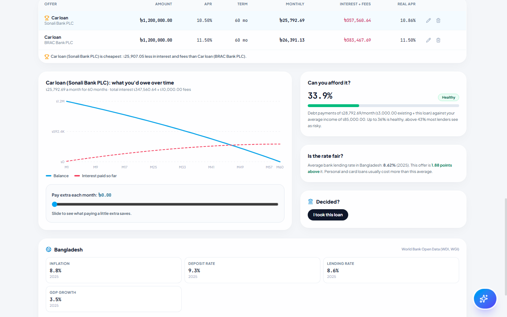
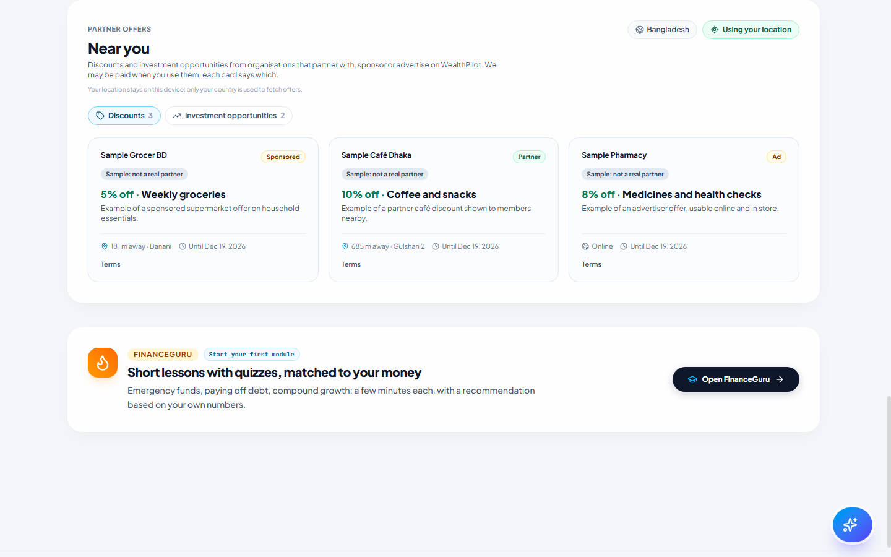

# WealthPilot
<p align="center">
  
</p>

<h1 align="center">WealthPilot</h1>

<p align="center">
  A Personal Finance and Wealth Management Workspace
</p>

<p align="center">
  Built for the Shenzhen International FinTech Competition 2026
</p>

<p align="center">
  <a href="https://darkslategray-duck-848813.hostingersite.com/">
    
  </a>
  <a href="https://github.com/aseerawsaf45-dev/WealthPilot">
    
  </a>
</p>

---
**A personal finance workspace with exact money, a grounded AI copilot, a debt and wealth planner, and location-aware partner offers.**
Built for the Shenzhen International FinTech Competition 2026.

| | |
|---|---|
| Live application | <!-- meta:liveUrl -->to be added<!-- /meta --> |
| Source code | https://github.com/aseerawsaf45-dev/WealthPilot |
| Team | <!-- meta:team -->WealthPilot Team<!-- /meta --> |
| Documentation | [Technical documentation](docs/TECHNICAL_DOCUMENTATION.md) · [Deployment](docs/DEPLOYMENT.md) · [Test cases](docs/TEST_CASES.md) · [Sandbox operation logs](docs/SANDBOX_OPERATION_LOG.md) |
| Word versions | [`submission/`](submission/) |

## What it does

- **Ledger in any currency.** Accounts in every ISO-4217 currency, transactions with splits, budgets, goals, bills and debts. Amounts are integer minor units; balances are derived from the ledger, never stored.
- **Import without uploading.** CSV, Excel, PDF statements and photographed receipts are read **on the device** (pdf.js, tesseract.js OCR). You review and edit every row before it is saved; imports are idempotent and can be undone.
- **AI copilot that cannot invent numbers.** Questions are answered from server-computed facts. The model (opt-in) only words the answer through placeholders and never sees amounts or personal data. Commands ("pay Netflix", "apply the growth mix to Kids education", "take the Sonali Bank loan") become proposals that run only after you confirm.
- **Explainable insights.** Recurring-payment detection, unusual-spending alerts (modified z-score), a 30/60/90-day cash forecast with a P10–P90 band, budget pacing, and goal ETAs. Each says how it was computed.
- **Debt and wealth planner.**
  - Snowball vs avalanche payoff.
  - A loan calculator, "how much can I borrow", offer comparison with fees (effective APR), and turning an offer into a debt.
  - Investment plans by country, using World Bank data and political stability, with stress tests for war, sanctions, oil shocks or a currency crash.
  - Five history-based fund mixes you can apply and edit.
  - Banks to compare in 158 countries, with recent news.
- **Partner offers near you.** Discounts and investment opportunities from organisations that partner with, sponsor or advertise on WealthPilot. They are sorted by distance computed in your browser; your location never leaves the device. Every card states the relationship.
- **Security and privacy by design.**
  - Revocable server sessions, CSRF checks, and every query scoped to the signed-in user.
  - A hash-chained audit log.
  - Rate limits and card-number blocking.
  - GDPR export and full erasure.

## Screenshots

| Overview with explainable insights | Copilot proposal (nothing saved until you confirm) |
|---|---|
|  |  |
| **Loan offers compared** | **Partner offers near you** |
|  |  |

## Tech stack

| Area | Choice |
|---|---|
| Framework | Next.js 16 (App Router, route handlers as the API), React 19, TypeScript 5 (strict) |
| Data | Neon Postgres, Prisma 6 (BigInt money, interactive transactions), 24 tables, 9 migrations |
| Validation | Zod 4 at every API boundary |
| Auth | bcrypt (cost 12), HMAC-signed HttpOnly cookie + revocable `Session` rows |
| AI | Groq (primary, zero data retention), optional Gemini backup; rule-based answers work with no key |
| On-device reading | pdf.js, tesseract.js, SheetJS, heic2any (self-hosted under `/vendor`) |
| Public data | World Bank, Wikidata, GDELT, Yahoo Finance chart history, open.er-api FX |
| UI | Tailwind CSS 4, Motion, Lucide icons |

## Quick start (local)

Requirements: **Node.js 20 or newer** (tested on 24.12), npm, and a Postgres database (a free Neon project works).

```bash
git clone https://github.com/aseerawsaf45-dev/WealthPilot.git
cd WealthPilot
npm install                       # also runs prisma generate and copies the on-device readers to /public/vendor
cp .env.example .env              # then fill DATABASE_URL, DATABASE_URL_UNPOOLED, SESSION_SECRET, AUDIT_PEPPER, APP_URL
npx prisma migrate deploy         # creates the 24 tables
npm run dev                       # http://localhost:3000
```

Generate the two secrets with:

```bash
node -e "console.log(require('crypto').randomBytes(32).toString('base64url'))"
```

AI keys (`GROQ_API_KEY`, optional `GEMINI_API_KEY`) are optional: without them the copilot gives calculated answers. Production deployment (Hostinger + Neon) is described in [docs/DEPLOYMENT.md](docs/DEPLOYMENT.md).

## Scripts

| Command | What it does |
|---|---|
| `npm run dev` | Development server |
| `npm run build` / `npm start` | Production build and server (always `NODE_ENV=production`, via `scripts/next-prod.mjs`) |
| `npm test` | 115 unit and logic tests (no database needed) |
| `npm run test:integration` | 15 database integration tests (point `DATABASE_URL` at a **test branch**) |
| `npm run eval:ai` | 57 AI copilot evaluations with scripted fake models |
| `npm run check:security` | Secret scan, layering rules, compliance gates |
| `npx tsx scripts/sandbox-run.mts` | Simulated-account run over HTTP (deliverable 06 evidence) |
| `npx tsx scripts/test-catalogue.mts` | Regenerates `docs/TEST_CASES.md` from real runs |
| `npm run docs:build` | Regenerates the Word documents in `submission/` |
| `npx tsx scripts/fetch-banks.mts` | Refreshes the bundled bank list (Wikidata) |
| `npx tsx scripts/seed-sample-offers.mts` | Loads clearly labelled sample partner offers (`--remove` deletes them) |

## Project structure

```
src/
  app/                  Next.js app; api/v1/** = 54 route files (the HTTP API)
  components/           UI tabs and widgets (planner/, import/, motion/)
  context/              FinanceContext (client state that mirrors the server)
  lib/                  Shared deterministic code: money, fx, ml/, planning/, extract/, geo
  server/
    http.ts             Envelopes, CSRF check, sessions, admin guard
    schemas.ts          Zod trust boundary
    rateLimit.ts        Postgres fixed-window limiter
    audit.ts            SHA-256 hash-chained audit log
    repos/              All database access, scoped by the session user
    ai/                 Copilot: router, tools, commands, orchestrator, privacy, providers
prisma/                 schema.prisma and 9 migrations
scripts/                Tests, evals, sandbox run, docs build, data refresh, build helpers
docs/                   Technical documentation, deployment, test cases, sandbox log, diagrams
submission/             Word (.docx) versions and execution evidence
```

## Testing

```bash
npm test && npm run eval:ai && npx tsc --noEmit && npm run check:security
```

Latest results (`docs/TEST_CASES.md`): **115/115** unit tests, **15/15** integration tests, **57/57** AI evaluations, 0 type errors, all security gates passed. The sandbox run passed **63/63** operations, including ten refused attacks and an intact audit chain.

## Security summary

- **Sessions:** server-side, revocable sessions; CSRF origin checks; Zod validation; per-user rate limits.
- **Isolation:** every query is scoped to the session user, and another user's ids return 404.
- **Exact money:** integer minor units; balances derived, never stored.
- **Audit:** a hash-chained audit log written in the same transaction as each change.
- **AI privacy:** the AI never sees amounts, rows or personal data, every number in an answer is computed by the server, and AI is opt-in with versioned consent.
- **Device privacy:** files and location stay on the device.
- **Data rights:** GDPR export and full erasure.

Details, threat model and known risks: [docs/TECHNICAL_DOCUMENTATION.md §4](docs/TECHNICAL_DOCUMENTATION.md).

## License

Competition submission. All rights reserved by the team unless stated otherwise.

## Team

**Md. Rezwanur Rahman Utshaw**  
*Department of Industrial Engineering and Management*  
Khulna University of Engineering & Technology (KUET), Bangladesh

**Gazi Faysal Jubayer**  
*Department of Mechanical Engineering*  
Khulna University of Engineering & Technology (KUET), Bangladesh

**Aseer Awsaf**  
*Department of Textile Engineering*  
Khulna University of Engineering & Technology (KUET), Bangladesh

**Salman Farshi Alam**  
*Department of Textile Engineering*  
Khulna University of Engineering & Technology (KUET), Bangladesh

**Sanjid Hasan**  
*Department of Electrical and Electronic Engineering*  
Khulna University of Engineering & Technology (KUET), Bangladesh
