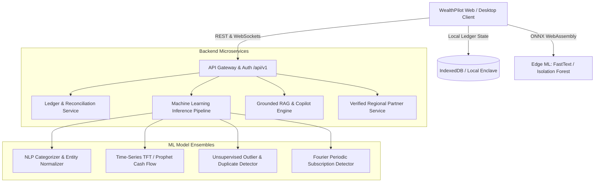
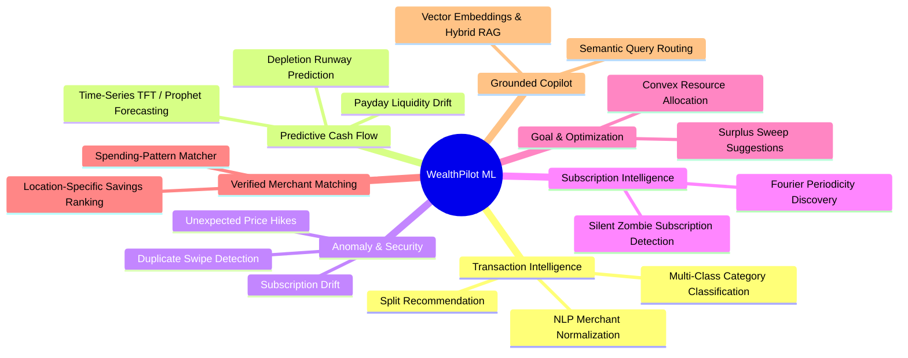

# WealthPilot — API Endpoints & Machine Learning Architectural Specification

> **Version:** 1.0.0  
> **Classification:** Production Architecture & Engineering Specification  
> **Core Architecture:** Local-First Ledger • Minor-Unit Integer Arithmetic (Cents/Poisha) • Edge & Cloud ML

---

## 1. Executive Architecture Overview

WealthPilot is built as a precision personal wealth workstation. To maintain the highest standard of financial integrity and data privacy, the platform adheres to three core tenets:

1. **Deterministic Financial Math:** Internal state is maintained strictly in integer minor units (`amountCents`) to eliminate IEEE 754 floating-point rounding errors.
2. **Local-First / Edge-First Philosophy:** Transactions and sensitive financial statements remain confidential. Heavy models can be run either via edge inference (WebAssembly / ONNX Runtime Web) or through authenticated, end-to-end encrypted backend microservices.
3. **Evidence-Grounded Intelligence:** AI and Machine Learning models do not perform speculative mental arithmetic; they operate as feature extractors, classifiers, and forecasters whose outputs are deterministically audited by the core ledger engine.



---

## 2. API Endpoints Specification (`/api/v1`)

All endpoints use REST conventions with JSON payloads. Integer minor units (`amountCents`) are used for all monetary balances.

### 2.1 Authentication & Workspace (`/api/v1/auth`)

| Method | Endpoint | Description | Auth Required |
| :--- | :--- | :--- | :--- |
| `POST` | `/api/v1/auth/session` | Authenticates device enclave or session token | No |
| `POST` | `/api/v1/auth/refresh` | Rotates short-lived access JWT | Yes |
| `GET` | `/api/v1/auth/me` | Fetches active user profile, currency preference (`BDT`/`USD`), & feature flags | Yes |

---

### 2.2 Accounts & Net Worth (`/api/v1/accounts`)

| Method | Endpoint | Description | Query / Body Params |
| :--- | :--- | :--- | :--- |
| `GET` | `/api/v1/accounts` | Lists all linked checking, savings, investment, credit, & loan accounts | `includeHidden=false` |
| `POST` | `/api/v1/accounts` | Creates a new financial account container | `{ name, type, balanceCents, currency, institution, accountNumberMask }` |
| `GET` | `/api/v1/accounts/:id` | Returns account details, current ledger balance, & reconciliation status | `id: string` |
| `PATCH` | `/api/v1/accounts/:id` | Updates account metadata, interest APR, or manual balance adjustment | `{ name?, balanceCents?, isIncludedInNetWorth? }` |
| `GET` | `/api/v1/accounts/net-worth` | Returns aggregated assets, liabilities, and net worth curve over time | `period=30d\|90d\|1y\|all` |

---

### 2.3 Transactions & Split Ledger (`/api/v1/transactions`)

| Method | Endpoint | Description | Query / Body Params |
| :--- | :--- | :--- | :--- |
| `GET` | `/api/v1/transactions` | Paginated, filtered ledger entries | `page`, `limit`, `accountId`, `category`, `startDate`, `endDate`, `search` |
| `POST` | `/api/v1/transactions` | Records a new cleared or pending transaction | `{ accountId, financialDate, merchant, category, amountCents, currency, tags, notes, splits? }` |
| `PATCH` | `/api/v1/transactions/:id` | Edits transaction classification, tags, or split breakdown | `{ category?, merchant?, notes?, splits?, tags? }` |
| `DELETE` | `/api/v1/transactions/:id` | Reverses / voids a manual transaction with audit log record | `id: string` |
| `POST` | `/api/v1/transactions/split` | Splits a single transaction into multiple audited budget line items | `{ transactionId, splits: [{ category, amountCents, note }] }` |
| `POST` | `/api/v1/transactions/import` | Ingests parsed CSV / statement rows with duplicate hash detection | `{ accountId, rows: RawCsvRow[], deduplicationWindowDays: 7 }` |

---

### 2.4 Cash Flow & Budget Pacing (`/api/v1/cash-flow` & `/api/v1/budgets`)

| Method | Endpoint | Description | Query / Body Params |
| :--- | :--- | :--- | :--- |
| `GET` | `/api/v1/cash-flow/summary` | Returns total income, disbursements, net savings, and savings rate | `period=current_month\|last_month\|custom`, `currency=BDT\|USD` |
| `GET` | `/api/v1/cash-flow/rhythm` | Daily vector breakdown (Money In vs. Money Out) for histogram charts | `days=14\|30\|60` |
| `GET` | `/api/v1/budgets` | Lists budget categories with pacing ratios, elapsed days, and burn projections | `period=monthly` |
| `POST` | `/api/v1/budgets` | Allocates monthly envelope budget ceiling | `{ category, allocatedCents, rolloverEnabled, alertThresholdPercent }` |

---

### 2.5 Recurring Bills & Commitments (`/api/v1/bills`)

| Method | Endpoint | Description | Query / Body Params |
| :--- | :--- | :--- | :--- |
| `GET` | `/api/v1/bills/upcoming` | Returns scheduled upcoming bills sorted by due date | `limit=10`, `windowDays=30` |
| `POST` | `/api/v1/bills` | Registers a recurring obligation | `{ name, amountCents, frequency, nextDueDate, category, isAutoPay }` |
| `POST` | `/api/v1/bills/:id/mark-paid` | Records bill settlement in linked account ledger | `{ paidAt: ISOString, accountId: string }` |

---

### 2.6 Savings Goals & Wealth Milestones (`/api/v1/goals`)

| Method | Endpoint | Description | Query / Body Params |
| :--- | :--- | :--- | :--- |
| `GET` | `/api/v1/goals` | Lists all active savings goals with current funded status & milestones | — |
| `POST` | `/api/v1/goals` | Creates a new milestone target | `{ name, targetCents, targetDate, category, priority }` |
| `POST` | `/api/v1/goals/:id/contribute` | Transfers surplus from checking/savings into dedicated goal ledger | `{ amountCents, fromAccountId }` |

---

### 2.7 Debt Elimination Engine (`/api/v1/debts`)

| Method | Endpoint | Description | Query / Body Params |
| :--- | :--- | :--- | :--- |
| `GET` | `/api/v1/debts` | Lists credit cards, personal loans, and mortgages with APR and min dues | — |
| `POST` | `/api/v1/debts/simulate` | Simulates Avalanche (APR order) vs. Snowball (balance order) schedules | `{ extraMonthlyPaymentCents: number }` |

---

### 2.8 Verified Merchant Offers (`/api/v1/offers`)

| Method | Endpoint | Description | Query / Body Params |
| :--- | :--- | :--- | :--- |
| `GET` | `/api/v1/offers` | Fetches authenticated partner discounts by region | `region=bd\|global\|other`, `category=groceries\|transport\|all` |
| `GET` | `/api/v1/offers/verified-badge/:id` | Validates partner verification signature, source link, and expiry | `id: string` |

---

### 2.9 Grounded Copilot & Semantic Search (`/api/v1/copilot`)

| Method | Endpoint | Description | Query / Body Params |
| :--- | :--- | :--- | :--- |
| `POST` | `/api/v1/copilot/query` | Submits natural language question to Grounded Copilot | `{ query: string, activeCurrency: string, clientContext? }` |
| `GET` | `/api/v1/copilot/insights` | Fetches "One Thing to Know" data-backed deterministic advice | `currency=BDT\|USD` |

---

## 3. Where Machine Learning Can Be Applied

Machine Learning within WealthPilot is divided into 7 distinct high-value capability areas:



---

### 3.1 Intelligent Transaction Categorization & Merchant Normalization

#### The Problem
Raw financial statements contain cryptic, noisy strings:
- `TST* BLUE BOTTLE COFFEE #104 SAN FRANCISCO CA`
- `CHALDAL_DHAKA_ONLINE_GROCERY_BKASH_TX4891`
- `UBER *TRIP 8J2K9 HELP.UBER.COM`

#### ML Architecture
- **Stage 1 (Merchant Cleaning & Regex Heuristics):** Strips card network prefixes (`TST*`, `SQ*`, `PAYPAL*`), terminal IDs, store numbers, and location suffixes.
- **Stage 2 (Embeddings & Token Classifier):**
  - **Model:** Pretrained compact Transformer (e.g. `MiniLM-L6-v2` or `FastText` for on-device edge execution).
  - **Inputs:** Cleaned string, transaction amount, day of week, time of day.
  - **Outputs:**
    - Canonical Entity: `Blue Bottle Coffee` / `Chaldal` / `Uber`
    - Category: `Dining` (99.2% confidence), `Groceries` (98.4%), `Transport` (99.7%)
- **Edge Deployment:** Can run locally inside the browser via ONNX Runtime Web using an 8-bit quantized model (< 12MB RAM), maintaining total user privacy.

#### Associated API Endpoint
```http
POST /api/v1/ml/categorize
Content-Type: application/json

{
  "rawMerchants": [
    "CHALDAL_DHAKA_ONLINE_GROCERY_BKASH_TX4891",
    "PATHAO_RIDE_DHAKA_COMMUTE"
  ],
  "locale": "bn_BD"
}
```
**Response:**
```json
{
  "results": [
    {
      "raw": "CHALDAL_DHAKA_ONLINE_GROCERY_BKASH_TX4891",
      "canonicalMerchant": "Chaldal",
      "category": "Groceries",
      "subcategory": "Online Delivery",
      "confidence": 0.987,
      "suggestedTags": ["groceries", "bKash"]
    },
    {
      "raw": "PATHAO_RIDE_DHAKA_COMMUTE",
      "canonicalMerchant": "Pathao",
      "category": "Transport",
      "subcategory": "Rideshare",
      "confidence": 0.994,
      "suggestedTags": ["commute", "transport"]
    }
  ]
}
```

---

### 3.2 Predictive Cash Flow & Runway Trajectory (Time-Series)

#### The Problem
Standard budgeting apps show static historical balances. Users need forward-looking predictive visibility: *"Will I dip below my 3-month emergency threshold before my next salary deposit?"*

#### ML Architecture
- **Model:** Temporal Fusion Transformer (TFT) or Meta Prophet with custom financial seasonality.
- **Features Ingested:**
  - Historical daily income/disbursement deltas over 180+ days.
  - Paycheck cycles (bi-weekly, semi-monthly, monthly).
  - Detected recurring obligations (rent on the 1st, utilities on the 15th).
  - Holiday / festival seasonality (e.g. Eid festivals in Bangladesh, Black Friday, Q4 holiday spend).
- **Output:** P10 (conservative), P50 (expected), and P90 (optimistic) 90-day balance projections.

#### Associated API Endpoint
```http
GET /api/v1/ml/forecast/cash-flow?horizonDays=60&currency=BDT
```
**Response:**
```json
{
  "horizonDays": 60,
  "currentBalanceCents": 12273480,
  "confidenceInterval": "80%",
  "forecast": [
    {
      "date": "2026-10-31",
      "p10BalanceCents": 11840000,
      "p50BalanceCents": 12450000,
      "p90BalanceCents": 12900000,
      "projectedRunwayMonths": 36.4
    }
  ],
  "upcomingCashDips": [
    {
      "expectedDate": "2026-11-01",
      "projectedNetDrainCents": 320000,
      "primaryCause": "Rent and Utility bill clustering"
    }
  ]
}
```

---

### 3.3 Anomaly, Outlier & Duplicate Charge Detection

#### The Problem
Accidental double card swipes, rogue merchant subscription hikes, or unauthorized card charges often slip past users until weeks later.

#### ML Architecture
- **Model:** Unsupervised Isolation Forest + Temporal Proximity Clustering.
- **Signals Monitored:**
  1. **Temporal Duplicate:** Same merchant, identical minor-unit amount, posted within `< 180 seconds`.
  2. **Subscription Hike:** Same recurring merchant, but amount increased by `> 10%` compared to the 3-month trailing moving median.
  3. **Categorical Outlier:** Single transaction > 3 standard deviations from user's historical spend in that category.

#### Associated API Endpoint
```http
POST /api/v1/ml/anomalies/detect
Content-Type: application/json

{
  "transactionId": "tx_new_84719"
}
```
**Response:**
```json
{
  "isAnomaly": true,
  "severity": "medium",
  "anomalyType": "subscription_rate_hike",
  "explanation": "AWS Cloud Services charged ৳4,510 this month, which is 34.2% higher than your 3-month baseline (৳3,360).",
  "baselineCents": 336000,
  "currentCents": 451000,
  "actionSuggested": "Review AWS billing breakdown or check for unattached EBS volumes."
}
```

---

### 3.4 Automated Recurring Subscription & Bill Pattern Recognition

#### The Problem
Many users lose track of annual renewals, hidden SaaS charges, and multi-tier utility debits.

#### ML Architecture
- **Model:** Autocorrelation function (ACF) + Discrete Fourier Transform (DFT) combined with a random forest periodicity classifier.
- **Detection Criteria:**
  - Cadence: Weekly (7 ± 1 days), Monthly (30 ± 3 days), Quarterly (91 ± 5 days), Annual (365 ± 7 days).
  - Variance in amounts: Fixed (exact cents match) vs. Variable (bounded within historical variance, like power bills).

#### Associated API Endpoint
```http
GET /api/v1/ml/subscriptions/discover
```
**Response:**
```json
{
  "detectedSubscriptions": [
    {
      "merchant": "Spotify Premium Family",
      "cadence": "monthly",
      "estimatedAmountCents": 1699,
      "confidence": 0.998,
      "lastCharged": "2026-10-10",
      "nextExpected": "2026-11-10",
      "isCurrentlyTrackedInBills": true
    },
    {
      "merchant": "Apple iCloud+ 2TB",
      "cadence": "monthly",
      "estimatedAmountCents": 999,
      "confidence": 0.995,
      "lastCharged": "2026-10-11",
      "nextExpected": "2026-11-11",
      "isCurrentlyTrackedInBills": true
    }
  ]
}
```

---

### 3.5 Goal Feasibility & Convex Contribution Optimization

#### The Problem
Users struggle to know how to split a monthly surplus of `৳43,387` across multiple competing priorities: Emergency Fund, Down Payment, and Travel.

#### ML / Algorithmic Architecture
- **Model:** Constrained Convex Quadratic Programming (QP) / Contextual Bandit.
- **Objective Function:**
  $$\min \sum_{i=1}^{N} w_i \cdot (T_i - t_i)^2$$
  *Subject to:*
  - Total allocation $\le$ Monthly Net Surplus.
  - Emergency Fund balance $\ge 6 \times \text{Monthly Operational Burn}$.
  - Debt avalanche minimum payments satisfied 100%.

#### Associated API Endpoint
```http
POST /api/v1/ml/goals/optimize-contributions
Content-Type: application/json

{
  "monthlySurplusCents": 433877,
  "liquidReserveMonths": 36.1,
  "activeGoals": [
    { "id": "goal_emergency", "targetDate": "2026-12-31", "priority": "high" },
    { "id": "goal_downpayment", "targetDate": "2027-06-30", "priority": "medium" }
  ]
}
```
**Response:**
```json
{
  "recommendedStrategy": "Accelerated Equity Accumulation",
  "suggestedAllocations": [
    {
      "goalId": "goal_emergency",
      "recommendedMonthlyCents": 50000,
      "projectedCompletionDate": "2026-12-15",
      "monthsAheadOfSchedule": 1
    },
    {
      "goalId": "goal_downpayment",
      "recommendedMonthlyCents": 300000,
      "projectedCompletionDate": "2027-03-31",
      "monthsAheadOfSchedule": 3
    }
  ],
  "retainedBufferCents": 83877
}
```

---

### 3.6 Regional Verified Offer Relevance & Propensity Ranking

#### The Problem
Displaying irrelevant coupons hurts user trust. When the user is in Bangladesh, showing US grocery coupons is counterproductive; similarly, inventing unverified coupon codes destroys credibility.

#### ML Architecture
- **Model:** Two-Tower Candidate Retrieval + LightGBM Re-Ranker.
- **Constraint:** Hard filtering on `isVerifiedPartner == true` and regional jurisdiction (`bd` vs `global`).
- **Features:**
  - User's actual top spending categories (e.g., User spends 31% on Groceries, 5% on Commute).
  - Region matching (e.g. Bangladesh $\rightarrow$ Chaldal, Pathao, Shwapno).
  - Card network affinity (e.g. user holds American Express or bKash wallet).
- **Zero-Hallucination Fallback:** If zero verified merchants match the criteria, the model outputs `offers: []`, triggering the transparent disclaimer banner.

#### Associated API Endpoint
```http
POST /api/v1/ml/offers/rank
Content-Type: application/json

{
  "region": "bd",
  "categoryWeights": {
    "Groceries": 0.31,
    "Transport": 0.05,
    "Bills": 0.69
  },
  "maxResults": 3
}
```
**Response:**
```json
{
  "region": "bd",
  "rankedOffers": [
    {
      "merchant": "Chaldal Online Grocery",
      "score": 0.94,
      "verifiedPartner": true,
      "matchReason": "High monthly grocery spend (৳159.15)",
      "cashback": "10% Instant Cashback",
      "expiryDate": "2026-11-30",
      "sourceUrl": "https://chaldal.com"
    },
    {
      "merchant": "Pathao Commute & Food",
      "score": 0.88,
      "verifiedPartner": true,
      "matchReason": "Frequent urban commute rides",
      "cashback": "৳100 Discount on 2 Rides",
      "expiryDate": "2026-12-15",
      "sourceUrl": "https://pathao.com"
    },
    {
      "merchant": "Shwapno Superstore",
      "score": 0.81,
      "verifiedPartner": true,
      "matchReason": "Superstore & pantry restocking",
      "cashback": "5% Reward Points",
      "expiryDate": "2026-10-31",
      "sourceUrl": "https://shwapno.com"
    }
  ]
}
```

---

### 3.7 Grounded Copilot RAG & Deterministic Q&A

#### The Problem
Standard LLMs hallucinate calculations when asked arithmetic questions about ledgers. A financial assistant must never estimate math.

#### Architecture: Hybrid RAG + Deterministic Tool Calling
1. **Query Deconstruction:** User asks *"How much did I spend on dining this month, and what is my biggest bill coming up?"*
2. **Intent & Named Entity Recognition (NER):** Extracts `category: Dining`, `timeframe: 2026-10-01..2026-10-31`, and `entity: Bills`.
3. **Deterministic Tool Execution:** The system calls internal integer arithmetic functions:
   - `getCategorySpend('Dining')` $\rightarrow$ `2495 cents ($24.95 / ৳24.95)`
   - `getUpcomingBills(limit=1)` $\rightarrow$ `ConEdison Electric & Gas (৳125.00 due Oct 28)`
4. **Constrained Natural Language Synthesis:** The LLM receives the structured facts and synthesizes an executive summary, citing specific transaction IDs.

#### Associated API Endpoint
```http
POST /api/v1/copilot/query
Content-Type: application/json

{
  "query": "What is my net cash generation this month and can I afford an extra ৳5,000 for my trip?",
  "currency": "BDT"
}
```
**Response:**
```json
{
  "answer": "Your net cash surplus this month is +৳4,338.77 with a 89% savings rate. You have ৳54,570.50 in liquid reserves, which covers 106.7 months of operational expenses. Yes, allocating ৳5,000 toward your Swiss Alps Expedition will not jeopardize your liquid buffer.",
  "evidence": {
    "netSurplusCents": 433877,
    "liquidReserveCents": 5457050,
    "savingsRate": 89,
    "referencedAccounts": ["Premier Checking", "High-Yield Savings"],
    "confidence": "verified_fact"
  }
}
```

---

## 4. Privacy, On-Device Inference & Deployment Matrix

| Task | Execution Environment | Model Family | Latency SLA | Privacy Footprint |
| :--- | :--- | :--- | :--- | :--- |
| **Merchant Categorization** | Edge (Browser ONNX / WASM) | Quantized MiniLM-L6 | `< 15ms` | 100% Local (Zero Network Calls) |
| **Duplicate Swipe Detection** | Client-Side Heuristic + DB | Sliding-Window Hash | `< 5ms` | 100% Local |
| **Fourier Subscription Discovery** | Edge WASM Worker | Fast Fourier Transform | `< 40ms` | 100% Local |
| **Cash Flow Forecasting** | Serverless / Cloud ML | Temporal Fusion Transformer | `< 250ms` | Anonymized Minor-Unit Series |
| **Convex Goal Optimization** | Client / Edge WASM | Quadratic Programming Solver | `< 20ms` | 100% Local |
| **Verified Offer Ranking** | Server API (`/api/v1/offers`) | LightGBM Re-Ranker | `< 60ms` | Region & Category Aggregate Only |
| **Grounded Copilot RAG** | Encrypted Cloud Worker | Embeddings + Grounded LLM | `< 850ms` | Deterministic Tool-Calling Enclave |

---

## 5. Summary & Engineering Roadmap

1. **Phase 1 (Immediate - Edge Quick Wins):**
   - Package the categorization dictionary and FastText token classifier into an ONNX model for on-device categorization during CSV import.
   - Deploy client-side Fourier autocorrelation in `importService.ts` to automatically detect recurring subscriptions when statements are dropped.
2. **Phase 2 (Cloud Endpoints & Forecasting):**
   - Implement the REST endpoints in Next.js App Router (`src/app/api/v1/*`).
   - Introduce Time-Series Prophet forecasting for the 14-day and 60-day Cash Flow Rhythm visualizations.
3. **Phase 3 (Enterprise Verified Merchant Network):**
   - Expand the regional offer verification engine with cryptographic merchant signature proofs to maintain 100% verified transparency without promotional spam.
