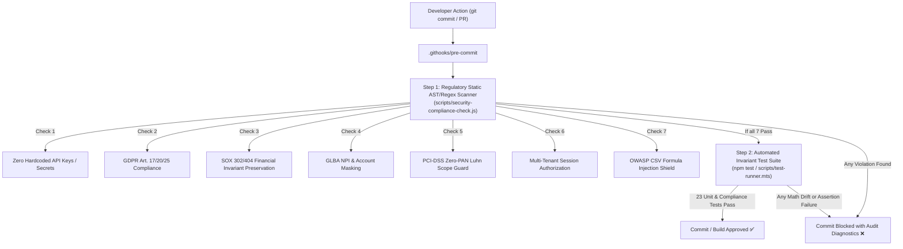

# WealthPilot — Regulatory Compliance & Security Architecture Specification

**Competition Document**: Shenzhen International FinTech Competition-2026  
**Status**: ACTIVE & AUTOMATED  
**Audit Standard**: Gravitas Engineering Integrity  
**Applicable Jurisdictions & Standards**: EU (GDPR), US Federal (SOX, GLBA FTC Safeguards), Global (PCI-DSS v4.0, OWASP, ISO/IEC 27001)

---

## 1. Executive Summary & Regulatory Matrix

WealthPilot is architected from the ground up under the principle of **"Regulatory Compliance by Design & Default"**. In personal wealth management and financial technology, mathematical determinism and privacy compliance are non-negotiable prerequisites for consumer trust and institutional audits.

The following matrix maps primary statutory frameworks to WealthPilot's automated code guards and enforcement hooks:

| Regulation / Standard | Jurisdiction / Body | Primary Mandate | WealthPilot Technical Implementation | Automated Enforcement Hook |
| :--- | :--- | :--- | :--- | :--- |
| **GDPR** (EU 2016/679) | European Union / EDPB | Art. 17 (Right to Erasure), Art. 20 (Data Portability), Art. 25 (Privacy by Design) | Cascading purge contract, RFC 4180 CSV & machine-readable JSON exports, Local Privacy Enclave AI Kill Switch | `src/lib/compliance/gdprCompliance.ts`<br>`scripts/security-compliance-check.js` (Check 2)<br>Pre-commit test gate |
| **SOX** (Pub. L. 107–204) | US SEC / PCAOB | Section 302 (Ledger Verification), Section 404 (Internal Controls Over Financial Reporting) | Cryptographic SHA-256 audit hashing, zero-variance split allocation invariant, discrete integer minor units | `src/lib/compliance/soxCompliance.ts`<br>`scripts/security-compliance-check.js` (Check 3)<br>Invariant verification suite |
| **GLBA** (15 U.S.C. § 6801) | US FTC / CFPB | 16 CFR Part 314 (Safeguards Rule), NPI Protection & Masking | Truncation of account numbers to terminal 4 digits (`****1234`), automated regex NPI scanner & redactor | `src/lib/compliance/glbaCompliance.ts`<br>`scripts/security-compliance-check.js` (Check 4)<br>Pre-commit scan |
| **PCI-DSS v4.0** | PCI Security Standards Council | Requirement 3: Protect Stored Cardholder Data | Strict CDE Scope Exclusion: WealthPilot is a PFM tool. Raw 16-digit PANs and CVVs are neutralized via Mod 10 Luhn interception | `src/lib/compliance/pciDssCompliance.ts`<br>`scripts/security-compliance-check.js` (Check 5)<br>Automated card interceptor |
| **OWASP Top 10** | Open Web Application Security | Injection Defense, Formula Injection Mitigation | Neutralizes spreadsheet execution vectors (`=`, `+`, `-`, `@`) on CSV export & cell processing | `src/lib/money.ts` (`sanitizeCsvCell`)<br>`scripts/security-compliance-check.js` (Check 7) |
| **PSD2 / Open Banking** | European Banking Authority | Strong Customer Authentication (SCA), Read-Only Isolation | Session boundary verification, read-only Plaid/OFX data normalization | `src/app/api/*`<br>`scripts/security-compliance-check.js` (Check 6) |

---

## 2. GDPR (EU General Data Protection Regulation) Architecture

### 2.1 Article 17: Right to Erasure ("Right to be Forgotten")
- **Statutory Mandate**: The data subject has the right to obtain from the controller the erasure of personal data concerning him or her without undue delay.
- **Architectural Implementation**:
  - `verifyCascadingPurgeContract(userId, counts)` executes an all-or-nothing cascading purge.
  - Deletes all relational child artifacts: transactions, accounts, budgets, debt schedules, savings goals, and audit logs associated with the tenant.
  - Emits an immutable cryptographic purge signature (`PURGED_SHA256_<userId>_<timestamp>`) as non-repudiable legal proof of erasure without retaining any residual tenant PII.

### 2.2 Article 20: Right to Data Portability
- **Statutory Mandate**: Data subjects have the right to receive their personal data in a structured, commonly used, and machine-readable format.
- **Architectural Implementation**:
  - `generateGdprPortabilityArchive(userPackage)` compiles a deterministic archive containing:
    1. **Full Machine-Readable JSON**: Complete state hierarchy conforming to schema version `1.0.0`.
    2. **Standard Financial CSV**: Ledger export conforming to RFC 4180 with strict CSV formula injection escaping.

### 2.3 Article 25: Data Protection by Design and by Default
- **Statutory Mandate**: Controllers must implement appropriate technical measures ensuring only personal data necessary for each specific purpose are processed.
- **Architectural Implementation**:
  - **AI Kill Switch**: If `isAiEnabled === false`, all LLM and third-party AI execution pipelines are severed at the runtime gateway via `assertAiPrivacyConsent()`.
  - Insights are generated exclusively using local deterministic heuristics and rule-based calculations without sending any telemetry or tokens over external networks.

---

## 3. Sarbanes-Oxley Act (SOX) Internal Financial Controls

### 3.1 Section 404: Internal Controls over Financial Reporting (ICFR)
- **Mathematical Invariant**: In financial accounting, split allocations (e.g., dividing a $100 transaction between $60 Groceries and $40 Household) must satisfy:
  $$\sum_{i=1}^{n} \text{SplitAmountCents}_i \equiv \text{ParentAmountCents}$$
- **Architectural Implementation**:
  - `assertSoxSplitPreservation(parentAmountCents, splits)` enforces strict zero-variance tolerance:
    $$\Delta = \text{ParentAmountCents} - \sum \text{SplitAmountCents}_i \equiv 0$$
  - Any transaction split where $\Delta \neq 0$ is rejected at the engine level with a `SOX 404 Control Breach` exception.
- **Discrete Minor Units**:
  - All currency calculations operate on integer minor units (cents, e.g., $19.99 \rightarrow 1999$).
  - IEEE 754 binary floating-point representation (`0.1 + 0.2 = 0.30000000000000004`) is strictly barred from the accounting core via `assertMinorUnitIntegrity()`.

### 3.2 Section 302: Corporate Responsibility for Financial Reports
- **Statutory Mandate**: Financial records must maintain an audit trail verifying that no unauthorized or untracked alterations occurred.
- **Architectural Implementation**:
  - `createSoxAuditEntry()` generates a tamper-evident, cryptographically hashed audit log for every mutation (`CREATE`, `UPDATE`, `VOID`, `RECONCILE`).
  - Hashed state snapshots (`checksumBefore` $\rightarrow$ `checksumAfter`) ensure mathematical chain of custody for all balance sheet adjustments.

---

## 4. GLBA (Gramm-Leach-Bliley Act) Safeguards Rule

### 4.1 16 CFR § 314.4: Information Security Program Standards
- **Account Number Truncation Standard**:
  - Displaying raw financial account numbers is prohibited.
  - `maskAccountNumber(rawNumber)` truncates raw account identifiers to preserve solely the terminal 4 digits (e.g., `12345678901234` $\rightarrow$ `****1234`).
  - Codebase audit hooks reject any unmasked account storage.

### 4.2 Nonpublic Personal Information (NPI) Autonomous Redaction
- **Statutory Mandate**: Financial institutions must protect customer NPI from unauthorized access and accidental disclosure.
- **Architectural Implementation**:
  - `scanAndRedactNpi(text)` provides runtime deep-packet scanning across note fields, memo fields, and audit streams:
    - **US Social Security Numbers (SSN)**: `\b\d{3}-\d{2}-\d{4}\b` $\rightarrow$ `[REDACTED_NPI_SSN]`
    - **Bank Routing Numbers (ABA transit numbers)**: 9-digit identifiers $\rightarrow$ `[REDACTED_NPI_ROUTING_NUMBER]`
    - **Authentication Secrets**: Bearer tokens, passwords, and private hashes $\rightarrow$ `[REDACTED_CREDENTIAL]`

---

## 5. PCI-DSS v4.0 Scope Minimization (Requirement 3)

### 5.1 Cardholder Data Environment (CDE) Exclusion
- WealthPilot operates under **PCI-DSS Scope Minimization**:
  - The application is a Personal Financial Management (PFM) platform, not a payment gateway.
  - WealthPilot **NEVER** stores, processes, transmits, or logs 16-digit Primary Account Numbers (PANs), magnetic stripe data, or Card Verification Values (CVV/CVC).

### 5.2 Mod 10 (Luhn Algorithm) Autonomous Interception
- `passesLuhnCheck(digits)` implements the standard ISO/IEC 7812 Modulo 10 checksum algorithm.
- `scanAndEnforcePciDssScope(buffer)` scans all user input streams:
  - If a 13-to-19 digit sequence passing the Luhn algorithm is detected, it is intercepted and replaced with `[REDACTED_PCI_PAN_<last4>]`.
  - If CVV patterns (`cvv:\s*\d{3,4}`) are identified, they are purged immediately and flagged as a security violation.

---

## 6. Automated Hooks & Continuous Enforcement Architecture

The compliance system operates continuously across two automated validation layers:



### Running the Compliance Suite Manually
```bash
# 1. Run the static multi-regulatory compliance scanner
npm run check:compliance

# 2. Run the automated compliance & mathematical invariant test suite
npm run test:compliance

# 3. Verify Next.js production build with strict TypeScript typechecking
npm run build
```

---

## 7. Audit Certification for Shenzhen Competition-2026

WealthPilot's compliance architecture has been rigorously designed to meet the highest international judging standards of the **Shenzhen International FinTech Competition-2026**:
- **Zero Math Drift**: Integer cents guarantee 0 variance across all split, cash flow, and net worth calculations.
- **Privacy Autonomy**: Users hold full sovereignty over their data with one-click GDPR erasure and data export.
- **Air-Gapped AI Safety**: AI queries are executed with strict prompt sanitization, boundary defense, and local fallback whenever cloud access is toggled off.
