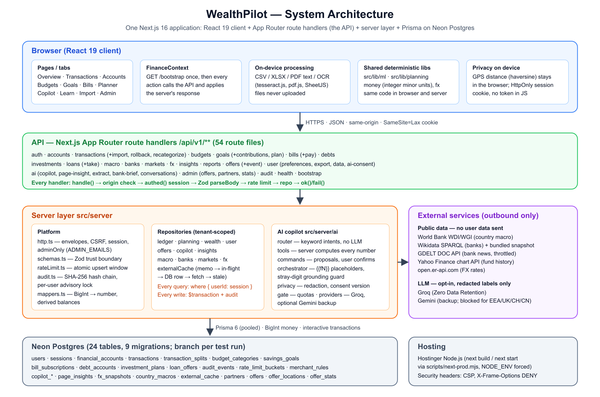
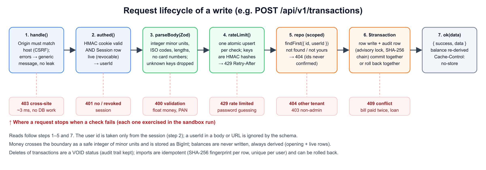
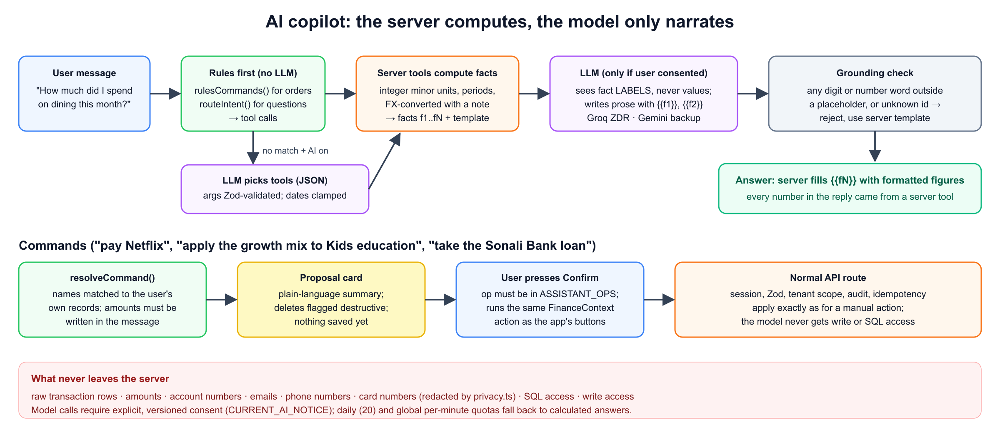

# WealthPilot: Technical Documentation

**Deliverable 01 · System architecture, core algorithms and security design**

| | |
|---|---|
| Product | WealthPilot: a personal finance workspace with a grounded AI copilot, debt and wealth planner, and partner offers |
| Team | <!-- meta:team -->Joker<!-- /meta --> |
| Live application | <!-- meta:liveUrl -->https://darkslategray-duck-848813.hostingersite.com/<!-- /meta --> |
| Source code | https://github.com/aseerawsaf45-dev/WealthPilot |
| Companion documents | README and deployment guide (deliverable 04), test cases (`docs/TEST_CASES.md`), sandbox operation logs (deliverable 06) |

## 1. Executive summary

Most personal-finance apps either keep data on one device (no sync, no backup) or send everything to a cloud and to an AI model that can invent numbers. WealthPilot is built on three rules that hold everywhere in the code:

1. **Money is exact.** Every amount is an integer number of minor units (cents, poisha), stored as `BigInt` in Postgres. Balances are never stored; they are derived from the ledger, so they cannot drift.
2. **The server computes; the AI only narrates.** Every number a user sees comes from deterministic server code. The language model never receives amounts, transaction rows or personal data. It writes sentences with placeholders, and the server fills them in. A sentence that states a number of its own is rejected.
3. **Every request is scoped to the signed-in user and audited.** The user id comes only from a revocable server session. Each write and its audit record commit in one database transaction, and the audit records form a SHA-256 hash chain that exposes any tampering.

On top of a full ledger (accounts in any ISO-4217 currency, transactions, splits, imports, budgets, goals, bills), WealthPilot offers:
- a debt and wealth planner: loans, investment plans by country, history-based fund mixes, and stress tests for war, sanctions or a currency crash;
- bank suggestions from public data;
- on-device document reading (receipts and statements);
- location-aware partner offers in which the location never leaves the device;
- an AI copilot that can answer questions and make changes, but only after the user confirms.

| Measure | Value |
|---|---|
| API route files / HTTP handlers | 54 / 79 |
| Database tables / migrations | 24 / 9 |
| Automated tests | 115 unit and logic, 15 database integration, 57 AI evaluations (all passing) |
| Sandbox evidence | 63 operations of two simulated users on a production build, 63/63 assertions passed, audit chain verified |

## 2. System architecture

### 2.1 Overview

WealthPilot is one Next.js 16 application. The React 19 client, the HTTP API (App Router route handlers under `src/app/api/v1`), and a server layer (`src/server`) share one TypeScript codebase. They also share the deterministic libraries in `src/lib`, so the browser and the server compute the same results. Data lives in Neon Postgres, accessed through Prisma 6.

| Layer | Location | Responsibility |
|---|---|---|
| Client | `src/app/page.tsx`, `src/components/**` | Tabs (Overview, Transactions, Accounts, Budgets, Goals, Bills, Planner, Copilot, Learn, Import, Settings, Admin). `FinanceContext` loads `GET /bootstrap` once, then every action calls the API and applies the server's response. |
| On-device processing | `src/lib/extract/**`, `public/vendor` | CSV/XLSX parsing, PDF text, OCR (tesseract.js), HEIC conversion, all in Web Workers. Files are never uploaded. |
| Shared deterministic code | `src/lib/ml`, `src/lib/planning`, `src/lib/money.ts`, `src/lib/fx.ts` | ML insights, forecast, loan, investment and market maths. Pure functions of (rows, today). |
| API | `src/app/api/v1/**/route.ts` | 54 route files, each a thin handler wrapped in `handle()`/`authed()`/`adminOnly()`. |
| Platform | `src/server/http.ts`, `schemas.ts`, `rateLimit.ts`, `audit.ts`, `mappers.ts` | Response envelopes, CSRF check, sessions, Zod trust boundary, rate limiting, audit hash chain, BigInt mapping. |
| Repositories | `src/server/repos/*.ts` | All database access, always scoped by the session user id. Routes never call Prisma directly (enforced by `npm run check:security`). |
| AI | `src/server/ai/*.ts` | Intent router, server tools, command proposals, grounded narration, privacy gateway, quotas, providers. |
| Database | `prisma/schema.prisma`, `prisma/migrations/*` | Neon Postgres; a branch per test run. |

### 2.2 Request lifecycle

Every route follows the same pipeline, so a security property implemented once applies everywhere.

1. `handle()` (`src/server/http.ts`) rejects a cross-site mutation: `Sec-Fetch-Site: cross-site`, or an `Origin` that does not match the host or `APP_URL`. It turns any thrown error into a generic message; database timeouts become a 503 "nothing was changed".
2. `authed()` verifies the HMAC-signed cookie **and** that its `Session` row is still live (not revoked, not expired). Only then does it pass `userId` to the handler.
3. `parseBody()` validates the JSON with a Zod schema (`src/server/schemas.ts`). Unknown keys are dropped, so a `userId` sent by the client is ignored.
4. `rateLimit()` counts the call in Postgres with one atomic upsert.
5. A repository function runs with `where: { userId }` on every query.
6. Writes run in `prisma.$transaction` together with `writeAudit()`.
7. `ok(data)` returns `{ success: true, data }` with `Cache-Control: no-store`.

### 2.3 Data model

All money columns are `BigInt` minor units, all rates are integer basis points (1% = 100 bps) or one-decimal percentages, and every user-owned table cascades on user deletion.

| Table | Purpose | Key rules |
|---|---|---|
| `users` | Profile, preferred currency, timezone, region, AI consent (version, providers) | Email unique; `passwordHash` bcrypt |
| `sessions` | Revocable server sessions | Checked on every request; logout and account deletion revoke them |
| `financial_accounts` | Accounts in any ISO-4217 currency | `openingBalanceCents`; the live balance is derived |
| `transactions` | Ledger rows | `status` CLEARED/PENDING/RECONCILED/VOID; `importFingerprint` unique per user; `importBatchId` for rollback |
| `transaction_splits` | Category splits | Sum must equal the transaction amount |
| `budget_categories` | Monthly budgets | Unique (user, category, month) |
| `savings_goals` | Goals, saved AI plan snapshot (JSON) | `currentCents` never below 0 |
| `bill_subscriptions` | Recurring bills | `nextDueDate` advanced by a conditional update (idempotent pay) |
| `debt_accounts` | Debts | APR as a rate, never summed |
| `investment_plans` | Plans by country and risk; fund allocation (JSON, weights = 100) | Scenarios from a fixed catalogue |
| `loan_offers` | Offers being compared | `considering` → `taken` (creates a debt) atomically |
| `audit_events` | Hash-chained audit log | `checksumBefore` / `checksumAfter` |
| `rate_limit_buckets` | Fixed-window counters | Keys are HMAC hashes, never raw emails or IPs |
| `merchant_rules` | The user's categorisation rules | Per user |
| `copilot_conversations`, `copilot_messages` | Saved chats (opt-in) | Deleted when history is turned off |
| `page_insights` | Cached AI page summaries | Keyed by a hash of the computed numbers |
| `fx_snapshots` | Daily exchange rates | Public data |
| `country_macros`, `external_cache` | World Bank, Wikidata, GDELT, Yahoo caches | Public data only, never user data |
| `partners`, `offers`, `offer_locations`, `offer_stats` | Partner discounts and investment opportunities | Stats are anonymous daily counters |

### 2.4 External integrations

| Source | Used for | Safeguards |
|---|---|---|
| World Bank WDI/WGI | Inflation, lending/deposit/real rates, GDP growth, political stability, FX trend, stock-market returns | 30-day cache; no user data sent |
| Wikidata SPARQL (CC0) | Banks per country | Bundled snapshot of 158 countries; live refresh waits at most 2.5 s |
| GDELT DOC API | Recent bank headlines | Global throttle of 1 request per 5.5 s; 6-hour cache; never blocks the page for more than 1.5 s |
| Yahoo Finance chart API | 10-year monthly history of 14 index funds | 15-minute cache with stale fallback (unofficial API; see risks) |
| open.er-api.com | Daily FX rates | Cached in `fx_snapshots` |
| Groq (primary LLM) / Gemini (backup) | Wording answers, choosing tools, structuring document text | Opt-in, versioned consent; labels and redacted text only; quotas |

Every public-data fetch goes through one cache (`src/server/repos/externalCache.ts`), in this order:
1. In-process memo.
2. A shared in-flight promise, so concurrent requests make one fetch.
3. A database row that is still within its TTL.
4. A live fetch.
5. The last stored row, if the fetch fails, with a back-off before retrying.

It never throws, so an outside outage degrades a feature instead of breaking a page.

### 2.5 Deployment architecture

Production runs as a Node.js app on Hostinger:
- `next build` and `next start` both run through `scripts/next-prod.mjs`, which forces `NODE_ENV=production` and caps thread pools for many-core hosts.
- The app uses Neon Postgres: a pooled URL at runtime, and an unpooled URL for migrations.
- Every test, migration rehearsal and sandbox run uses a separate Neon branch. Production data is never used for testing.
- Security headers come from `next.config.ts`:
  - a Content-Security-Policy (`default-src 'self'`, `connect-src 'self'`, `frame-ancestors 'none'`, `object-src 'none'`);
  - `X-Frame-Options: DENY`, `X-Content-Type-Options: nosniff` and `Referrer-Policy`;
  - a Permissions-Policy that blocks the camera, microphone and payments, and allows geolocation only for this site.

See `docs/DEPLOYMENT.md` for the step-by-step guide.

## 3. Core algorithms

All algorithms below are deterministic and explainable: the same inputs always give the same output, and each insight states its method ("How: modified z-score"). They live in `src/lib`, so the browser can show results instantly and the server can use the same code for API and AI answers.

### 3.1 Exact money arithmetic

WealthPilot stores monetary values as integer minor units rather than binary floating-point amounts. The exponent is currency-specific and is defined by `minorUnits` in `src/lib/currency.ts`: JPY uses zero decimal places, most listed currencies use two, and BHD uses three. Database money columns use PostgreSQL `BIGINT` through Prisma. API inputs are validated as safe integers before persistence.

**Minor-unit representation.** For currency \(c\), let \(d_c\) be its minor-unit exponent and \(A\) the user-entered amount in major units. The intended representation is

$$
M_c = \mathrm{round}_{\mathrm{halfAwayFromZero}}\!\left(A\,10^{d_c}\right)
$$

Here, \(M_c\) is an integer count of minor units. The actual parser (`toMinor` in `src/lib/money.ts`) parses decimal text using string arithmetic, pads or truncates fractional digits to the currency exponent, and rounds using the next digit. This avoids relying on binary floating-point arithmetic to parse a decimal string. Unparseable inputs and values outside JavaScript's safe-integer range return the documented fallback rather than being persisted as an arbitrary amount.

**Derived account balance.** Let \(O_i\) be account \(i\)'s opening balance and let \(T_i\) be its transactions. Its current ledger balance is derived as

$$
B_i = O_i + \sum_{t\in T_i,\;\mathrm{status}(t)\ne\mathrm{VOID}} a_t
$$

where \(a_t\) is the signed transaction amount in the account's currency. The ledger repositories (`listAccounts` and `accountWithBalance` in `src/server/repos/ledger.ts`) calculate this value; they do not maintain a separately mutable balance field. Setting a balance to target \(X\) creates an opening-balance adjustment equal to \(X-\sum_t a_t\) for the applicable non-VOID transactions.

**Split conservation.** For a transaction amount \(a\) divided into \(n\) category splits with amounts \(s_1,\ldots,s_n\), the invariant is

$$
\sum_{j=1}^{n}s_j=a
$$

`validateSplitPreservation` in `src/lib/money.ts` checks this equality exactly in minor units. A non-zero difference is a validation failure; no tolerance is applied.

**Foreign-exchange conversion.** Rates in `src/lib/fx.ts` are stored as integer strings scaled by \(S=10^9\), with \(r_c\) denoting units of currency \(c\) per one unit of the snapshot base currency. For a source amount \(M_f\), source currency \(f\), target currency \(t\), and exponents \(d_f,d_t\), conversion is

$$
M_t=\mathrm{round}_{\mathrm{even}}\!\left(\frac{M_f\,r_t\,10^{d_t}}{r_f\,10^{d_f}}\right)
$$

where \(\mathrm{round}_{\mathrm{even}}\) is round-half-to-even integer division. Same-currency conversion returns the original amount; if a rate is unavailable, conversion returns `null` and the total reports the omitted currency rather than silently mixing currencies. Cross-currency totals are estimates tied to the dated rate snapshot and should be labelled as such.

**Rounding and deletion.** The string parser uses half-away-from-zero rounding for entered decimal text; FX conversion uses half-to-even integer division. These are distinct, intentional boundaries. Deleting a transaction changes its status to `VOID`, preserving the audit record while excluding that row from the derived balance. The sandbox evidence includes rejection of an invalid floating-point amount at the API boundary.

### 3.2 Statement import: idempotent and reversible

1. Each row is validated on its own (`ImportRow`). Bad rows are reported with their index; they are never dropped silently. At most 2,000 rows per import.
2. **Fingerprint:** the row fingerprint is computed from the concatenation of date, lower-cased merchant, amount, and occurrence-in-file index:

   $$
   F=\mathrm{SHA256}(\mathrm{date}\,|\,\mathrm{lower}(\mathrm{merchant})\,|\,\mathrm{amount}\,|\,\mathrm{occurrence})
   $$

   The occurrence index keeps two otherwise identical same-day purchases distinct, while re-importing the same file reproduces the same fingerprints.
3. `createMany(..., skipDuplicates)` against the unique index `(userId, importFingerprint)` makes re-imports idempotent. The sandbox run imported a 7-row statement, then imported it again: 6 inserted, 1 rejected, then 0 inserted and 6 duplicates.
4. **Rollback:** every row of a batch shares `importBatchId`. Undo voids them and clears their fingerprints in one transaction, so the file can be imported again later.

### 3.3 Machine-learning insights (`src/lib/ml`)

| Model | Method | Guards |
|---|---|---|
| Categorisation (ML-01, `categorize.ts`) | Ordered evidence: the user's own rules, then what the user called this merchant before (share of past rows), then a short global keyword list | Suggestions only; the user confirms each change; confidence 0–100 |
| Recurring detection (ML-02, `recurring.ts`) | At least 3 distinct dates; median gap matches a known cadence within 20%; coefficient of variation < 0.15 for all observations or for earlier observations excluding the latest when there are at least 4 | Offers "Track as a bill" only if no similar bill exists |
| Unusual spending (ML-03, `anomalies.ts`) | Modified z-score per category, defined below; flag when \(z>3.5\). If MAD = 0, flag at \(x\geq 2\widetilde{x}\) | Needs ≥ 8 earlier expenses spanning ≥ 60 days |
| Cash-flow forecast (ML-04, `forecast.ts`) | 30/60/90 days: balance + expected recurring income − bills due − typical everyday spending. The P10–P90 band comes from the spread of real 30-day everyday-spending totals over the last 180 days, scaled to each horizon | Needs ≥ 60 days of history, otherwise says so; reports the first day the balance would go below zero |
| Goal ETA (ML-05, `monthly.ts`) | Months = remaining ÷ monthly saving, with ±20% sensitivity on the saving rate, giving a likely finish window | "Never at this rate" when saving ≤ 0 |
| Budget pacing | Spend projected to month end at the current pace, compared with the same days of the previous month | Like-for-like days, so a half month is compared fairly |

**Cash-flow forecast formulation.** For horizon \(H\in\{30,60,90\}\) days, the implementation counts recurring income events as \(I_H\), scheduled bills and recurring outflows as \(L_H\), and estimates everyday spending by scaling the median rolling 30-day everyday-spending total \(E_{30}\):

$$
E_H=\mathrm{round}\!\left(E_{30}\frac{H}{30}\right),\qquad
\widehat{B}_H=B_0+I_H-L_H-E_H
$$

The displayed range uses historical spread terms \(U\) and \(D\), derived from the 90th and 10th percentiles of rolling 30-day spending totals over up to 180 days:

$$
B_H^{\mathrm{low}}=\widehat{B}_H-\mathrm{round}\!\left(U\frac{H}{30}\right),\qquad
B_H^{\mathrm{high}}=\widehat{B}_H+\mathrm{round}\!\left(D\frac{H}{30}\right)
$$

These endpoints are labelled P10 and P90 in the interface, but they are heuristic bounds constructed by scaling empirical spending spreads; they are not calibrated probabilistic coverage intervals. Forecasting is withheld unless at least 60 days of transaction history are available. The implementation also estimates the first day the expected balance falls below zero by walking scheduled events day by day.

For unusual-spending detection, the category median and median absolute deviation (MAD) are computed from eligible historical expenses:

$$
\widetilde{x}=\mathrm{median}(x_1,\ldots,x_n),\qquad
\mathrm{MAD}=\mathrm{median}\bigl(|x_i-\widetilde{x}|\bigr)
$$

When \(\mathrm{MAD}>0\), the modified z-score for a candidate expense \(x\) is

$$
z=\frac{0.6745\,(x-\widetilde{x})}{\mathrm{MAD}}
$$

The implementation flags the candidate only when \(z>3.5\) and the category has at least eight earlier expenses spanning at least 60 days. When MAD is zero, the fallback is \(x\geq 2\widetilde{x}\); no z-score is reported for that fallback. These are deterministic heuristics, not a diagnosis of fraud or a statistical guarantee.

For recurring detection, let \(g\) be the median gap between distinct payment dates and \(d_c\) the nominal gap for cadence \(c\). The cadence test is

$$
|g-d_c|\leq 0.2d_c
$$

with nominal gaps of 7, 14, 30.4, 91.3, and 365.25 days for weekly, biweekly, monthly, quarterly, and annual cadence, respectively. The amount-stability coefficient is the population standard deviation divided by the mean, \(\mathrm{CV}=s/\bar{x}\). A series passes the amount-stability test when \(\mathrm{CV}<0.15\) for all amounts or, where at least four observations exist, for the earlier amounts excluding the latest observation.

**Goal completion estimate.** For remaining goal amount \(R\) and positive monthly saving rate \(M\), the estimated number of months is

$$
N=\left\lceil\frac{R}{M}\right\rceil
$$

The sensitivity window recomputes the estimate at \(1.2M\) and \(0.8M\):

$$
N_{\mathrm{early}}=\left\lceil\frac{R}{1.2M}\right\rceil,\qquad
N_{\mathrm{late}}=\left\lceil\frac{R}{0.8M}\right\rceil
$$

If \(R\leq0\), the estimate is zero; if \(M\leq0\) while money remains, the completion time is reported as unavailable (“never at this rate”). For a target date, the implementation estimates months remaining using 30.44 days per month and computes the required monthly amount by rounding up.

Statistics (medians, z-scores) use numeric ratios only; stored amounts remain integer minor units.

### 3.4 Goal planner

The planner (`planGoal` in `src/server/ai/tools.ts`) uses the user's recent completed-month history and accounts for other dated goals before recommending a saving rate.

Let \(I\) and \(E\) be average monthly income and expenses over up to three recent complete months. The estimated monthly surplus is

$$
S=I-E
$$

For each other dated goal \(g\), let \(R_g\) be its remaining amount and \(m_g\) the months remaining. The uncommitted monthly surplus is

$$
F=S-\sum_g\left\lceil\frac{R_g}{m_g}\right\rceil,\qquad C=\left\lfloor\frac{\max(0,F)}{2}\right\rfloor
$$

where \(C\) is the planner's “comfortable” monthly saving rate; half of the uncommitted amount is reserved as a buffer. For the goal being evaluated, with remaining amount \(R\) and \(m\) months left, the required monthly saving is

$$
Q=\left\lceil\frac{R}{m}\right\rceil
$$

The verdict is **not reachable** when \(F\leq0\) or \(Q>F\), **on track** when \(Q\leq C\), and **stretch** otherwise. These classifications depend on historical averages and entered dates; they are not guarantees of future affordability. The implementation also checks edge cases such as goals with no positive saving rate.

**Options when a goal is not on track.** The planner may move the deadline, trim flexible categories (largest first, not fixed costs such as rent), lower the target, or pause other goals. Each option is marked feasible or not. `applyGoalPlanOption` (`src/server/repos/planning.ts`) applies an option from the stored plan snapshot—not client-supplied replacement values—in one transaction. Budget cuts preserve the user's alert thresholds.

### 3.5 Debt payoff and loans (`src/services/debtService.ts`, `src/lib/planning/loans.ts`, `link.ts`)

- **Snowball vs avalanche:** a month-by-month simulation. Interest accrues at APR/12 (rounded to minor units) and minimums are paid. Freed-up minimums from paid-off debts roll into the next target (lowest balance first, or highest APR first). The simulation is capped at 360 months.
- **Monthly rate.** APR is represented in basis points (\(10{,}000\) bps = 100%). The monthly rate is \(r=\mathrm{APR}_{\mathrm{bps}}/(10{,}000\cdot12)\).
- **Equated monthly instalment (EMI).** For principal \(P\), monthly rate \(r\), and \(n\) payments,

  $$
  \mathrm{EMI}=\begin{cases}
  \left\lceil P/n\right\rceil, & r=0,\\[4pt]
  \left\lceil\dfrac{Pr}{1-(1+r)^{-n}}\right\rceil, & r>0.
  \end{cases}
  $$

  The implementation rounds the EMI up to an integer minor unit. Monthly interest is rounded to an integer, and the final payment is capped at the outstanding balance plus interest so the simulated balance reaches zero.
- **Effective APR including fees.** Let \(P_f=P-F\) be the net cash received after upfront fee \(F\), and \(A\) the computed EMI. The monthly effective rate \(q\) solves

  $$
  P_f=\sum_{k=1}^{n}\frac{A}{(1+q)^k}
  =\frac{A\bigl(1-(1+q)^{-n}\bigr)}{q},\quad q>0
  $$

  The code finds this rate by bisection for 80 iterations and reports the nominal annualised rate \(12q\) in basis points (rather than the compounded effective annual rate \((1+q)^{12}-1\)). If net proceeds or the EMI are non-positive, the implementation falls back to the stated APR.
- **Debt-to-income ratio (DTI).** For new EMI \(A_n\), existing monthly minimums \(M\), and average monthly income \(I>0\),

  $$
  \mathrm{DTI}(\%)=100\,\frac{A_n+M}{I}
  $$

  The UI classifies DTI up to 36% as healthy, above 36% through 43% as stretched, and above 43% as risky. These are product heuristics, not lender approval criteria.
- **Borrowing room.** For threshold \(p\in\{0.36,0.43\}\), monthly payment room is \(R_p=\max(0,\lfloor pI\rfloor-M)\). `maxPrincipal` inverts the EMI expression and steps down until the rounded EMI is no greater than \(R_p\).
- **Pay debt or invest?** A debt is "pay first" when its APR exceeds the plan's after-tax expected return. The same monthly amount is simulated both ways for the same duration (fair comparison).
- **Taking a loan** flips the offer from `considering` to `taken` with a conditional update. It also creates the debt, with the EMI as its minimum payment, in the same transaction, so a double click cannot create two debts. The sandbox run checks this (second attempt: 409).

### 3.6 Investment projection by country (`src/lib/planning/invest.ts`, `scenarios.ts`)

**Expected return.**
- The base is the country's deposit rate. If none is published, the lending rate − 3%; if that is missing, inflation + 1%; otherwise 5%. Each fallback is stated in the notes.
- Add a risk premium of 0 / 3 / 5% (conservative / balanced / growth), with yearly volatility of 5 / 10 / 16%.
- Political stability (World Bank WGI, −2.5…+2.5) below 0 lowers the return by 0.5% and widens volatility by 2%. Below −1, the figures are 1.5% and 4%.
- A user-entered return always wins and is labelled.

**Projection.** The balance is updated monthly using the assumed annual return converted to a monthly rate, with the monthly contribution added after growth. With annual return \(R\), monthly contribution \(C\), and current balance \(B_{m-1}\), the baseline recurrence is

$$
B_m=\mathrm{round}\!\left(B_{m-1}\left(1+\frac{R}{12}\right)\right)+C
$$

where the code uses the annual rate in basis points and rounds each balance update to integer minor units. The displayed range is a deterministic lognormal-style band, not a Monte Carlo simulation:

$$
P_{10}=B_m e^{-1.2816\sigma\sqrt{T_w}},\qquad
P_{50}=B_m,\qquad
P_{90}=B_m e^{1.2816\sigma\sqrt{T_w}}
$$

Here \(\sigma\) is the assumed annual volatility as a decimal, and \(T_w\) is the implementation's contribution-weighted time invested in years. The factor 1.2816 is the standard-normal 90th-percentile quantile used for a symmetric central 80% band. Because the volatility is a fixed risk-profile assumption and the model is deterministic, these bounds are illustrative scenario ranges, not calibrated coverage probabilities. The projection also divides by the cumulative inflation index to estimate value in today's money and multiplies by the currency-trend index for its USD-trend-adjusted view.

**Stress tests.** Seven fixed scenarios: regional conflict or war, sanctions and capital controls, oil shock, global rate hikes, local currency crash, political instability, global recession. Each one sets:
- an immediate shock, scaled by the plan's exposure (0.35 / 0.70 / 1.0 by risk);
- a return drift for a number of months;
- extra inflation and currency depreciation.

The reported stress loss is the worst first-year gap against the unstressed path. Politics enters **only** through the World Bank index and the scenarios the user picks; the AI never states current events.

### 3.7 History-based fund mixes (`src/lib/planning/markets.ts`)

**Universe.** 14 broad index ETFs:
- world, US, Europe, Japan, China, India, Asia ex-Japan, emerging markets, Latin America, Africa;
- gold, US bonds, international bonds, T-bills (cash).

**Statistics per fund** (`computeStats`), from 10 years of monthly closes:
- **Annualised return.** For a valid positive start price \(P_0\), end price \(P_n\), and \(n\) monthly intervals, \(R_{\mathrm{ann}}=(P_n/P_0)^{12/n}-1\). A history up to three months shorter than the requested window may be accepted and annualised over its observed span.
- **Annualised volatility.** For monthly returns \(r_1,\ldots,r_n\), the code computes their sample standard deviation \(s_r\) and reports \(\sigma_{\mathrm{ann}}=s_r\sqrt{12}\), provided at least 12 monthly returns exist.
- **Maximum drawdown.** If \(P_t\) is a price and \(H_t=\max_{u\leq t}P_u\) its running peak, the recorded maximum drawdown is \(\min_t(P_t/H_t-1)\). These are historical descriptive statistics, not forecasts.

**Five mixes.** Each starts from a base split of shares, bonds, gold and cash for the risk level, then applies its own tilt:

| Mix | Tilt | Region rule |
|---|---|---|
| Core | none | best return-for-risk regions, 40% of shares |
| Simple global | no gold; 3 funds | world fund only |
| Lower swings | −20 shares, +12 bonds, +5 gold, +3 cash | lowest-volatility regions |
| Growth tilt | +15 shares, −10 bonds, −5 cash | best 10-year return that still rose last year |
| Crisis-resilient | −20 shares, +5 bonds, +10 gold, +5 cash | lowest volatility; suggested when political stability < 0 or stress tests are on |

**Construction rules.**
- Under 3 years, half the shares move to cash.
- Weights are rounded to whole percents that sum to exactly 100 by the largest-remainder method.
- `mixStats` re-scores any edited mix as weighted averages of return, volatility and drawdown.
- The API refuses allocations that are not exactly 100%, contain unknown funds, or repeat a fund (`Allocation` Zod schema).

### 3.8 Bank suggestions (`src/lib/planning/banks.ts`, `src/server/repos/banks.ts`)

1. **Which banks exist.** A Wikidata SPARQL query starts from 10 bank types and only then filters by country (`hint:Query hint:optimizer "None"`). This takes 1–3 s, where the naive subclass walk timed out at 60 s for the US, India, Germany and the UK. It excludes defunct banks. A bank whose parent organisation is in another country is labelled the **local arm of an international bank**. A bundled snapshot (158 countries, `scripts/fetch-banks.mts`) is used whenever the live query does not answer within 2.5 s.
2. **News signal.** GDELT headlines from the last 30 days that name the bank, scored with a small, transparent lexicon. Words such as *fraud, penalty, losses, probe* count −1; *profit, expansion, award, partnership* count +1.
3. **Ranking score.** The deterministic score is

   $$
   S=2\log_2(1+f)+\min(a,6)+1.5s+\mathbb{1}_{\mathrm{local}}
   $$

   where \(f\) is the number of Wikipedia language editions, \(a\) is the count of matching articles (capped at six), \(s\) is the lexicon-derived headline signal, and \(\mathbb{1}_{\mathrm{local}}=1\) for a local bank and 0 otherwise.
   - **Caution:** the worst headline ≤ −2, or ≤ −1 with a negative total.
   - **Worth comparing:** the top three of the rest.
   - Every pick carries its reasons.
4. **Rates are not invented.** The country's World Bank average lending or deposit rate is shown as the benchmark, and users are told to ask each bank for a quote.

### 3.9 AI copilot: grounding by construction (`src/server/ai`)

1. **Rules first.** `rulesCommands()` recognises commands such as "add 450 lunch", "pay Netflix", "apply the growth mix to Kids education" or "take the Sonali Bank loan", including multi-step requests. `routeIntent()` maps common questions to tools by keyword. These need no model and cost no quota.
2. **Server tools compute the facts.** Thirteen read tools return `facts` (label, value, unit, kind) and a template with `{{#i}}` references: financial summary, category breakdown, compare periods, budget status, upcoming bills, possible duplicates, insights, debt summary, compare loans, investment outlook, savings plan, goal plan, partner offers.
3. **The model only narrates.** When the user has consented, the model receives the fact **labels**, never the values, and writes prose with `{{f1}}`-style placeholders. If no rule matched, the model only picks tools (strict JSON, validated with Zod). Implausible dates are clamped to the loaded history.
4. **Grounding check.** `hasStrayNumber` rejects model text that contains any digit or number word outside a placeholder, or a placeholder id that does not exist. In that case the server's own template is used. The server then fills the placeholders with its formatted figures, so **every number in an answer came from a server tool**. The 57 AI evaluations include hostile fake model replies that try to inject numbers. None succeed.
5. **Commands need confirmation.** `resolveCommand()` maps a command to a proposal:
   - names are matched only against the user's own records, and an ambiguous or unknown name gets a question back;
   - an amount must literally appear in the user's message, or the copilot asks for it, so the model cannot invent amounts;
   - deletes are flagged destructive.

   Nothing is saved until the user presses Confirm. The browser then runs the same `FinanceContext` action as the app's own buttons, through the normal API with all its checks.
6. **Document reading (opt-in).** The device extracts the text, `redactDocumentText` removes identifiers, and the model only structures the result. A row is kept only if its amount appears character for character in the text, its merchant appears in the text, and its date falls within −2/+1 years of today. Everything else is dropped and counted.

### 3.10 Partner offers near you (`src/components/NearbyOffers.tsx`, `src/server/repos/offers.ts`)

- **Visibility:** an offer is shown only when its status is `live`, today is between its start and end dates, and an admin verified it in the last 90 days.
- **Location stays on the device:** the browser asks for location only on a click (or if permission was already granted). It computes great-circle distance with the haversine formula

  $$
  d=2R\arcsin\!\left(\sqrt{\sin^2\!\left(\frac{\Delta\varphi}{2}\right)+\cos\varphi_1\cos\varphi_2\sin^2\!\left(\frac{\Delta\lambda}{2}\right)}\right)
  $$

  where \(R=6{,}371\) km, \(\varphi_1,\varphi_2\) are latitudes in radians and \(\Delta\varphi,\Delta\lambda\) are latitude and longitude differences in radians. Results are sorted nearest first. The server receives only the country.
- **Disclosure:** every card shows its relationship (Partner, Sponsored or Ad). Sample content is marked "Sample: not a real partner". Investment cards state they are not financial advice. Links carry only `utm_source=wealthpilot`.
- **Sponsor statistics:** anonymous daily counters, incremented with an atomic `upsert … increment` (verified: two simultaneous clicks count 2). No user id and no location are stored.

### 3.11 Rate limiter and audit chain

- **Rate limiter** (`src/server/rateLimit.ts`): a fixed window kept in Postgres, implemented as one atomic `INSERT … ON CONFLICT DO UPDATE` that resets the counter when the window has expired. It needs no shared memory, so it holds across processes. Keys are `scope:HMAC(identifier)`.
- **Audit chain** (`src/server/audit.ts`):
  - Each write inserts a chained digest in the same transaction as the change:

    $$
    h_i=\mathrm{SHA256}(h_{i-1}\,|\,u_i\,|\,e_i\,|\,a_i\,|\,d_i\,|\,t_i)
    $$

    where \(h_{i-1}\) is the previous checksum and \(u_i,e_i,a_i,d_i,t_i\) represent the user id, event type, actor, event details and timestamp fields. The vertical bars denote the implementation's canonical field concatenation, not a mathematical OR operation.
  - A per-user `pg_advisory_xact_lock` serialises concurrent writes, so the chain never forks.
  - Timestamps are strictly increasing.
  - The sandbox run recomputed 29 events end to end and found the chain intact.

## 4. Security design

### 4.1 Permission tiers

| Tier | Who | Can do | Enforced by |
|---|---|---|---|
| Anonymous | Not signed in | Landing page, sign up, sign in, health check | `authed()` returns 401 for everything else; app URLs are rewritten to the landing page |
| User | Valid, unrevoked session | Own data only: every query carries `userId` from the session | Repositories; cross-tenant access returns **404** (ids are never confirmed) |
| AI-consented user | User who accepted the current AI notice | Model-worded answers, model tool choice, optional AI document reading | `canUseLlm()` checks consent, notice version and provider on every call; region rules for Gemini |
| Admin | Session user whose email is in `ADMIN_EMAILS` (server environment) | Manage partners and offers, read anonymous offer statistics | `adminOnly()`; the client's `isAdmin` flag only shows the tab, every admin API re-checks |

### 4.2 Threat model (STRIDE)

| Threat | Example | Controls |
|---|---|---|
| Spoofing | Stolen or forged session | HMAC-SHA256 signed token (`SESSION_SECRET` ≥ 32 bytes, timing-safe compare), HttpOnly, Secure, SameSite=Lax cookie, 7-day expiry, **server-side Session row checked on every request**, revoked on logout and account deletion (sandbox: replayed cookie gets 401) |
| Spoofing | Password guessing | bcrypt cost 12, constant-time dummy compare for unknown emails, the same error for both cases, 10 attempts per email per hour, 20 per IP per 15 min (sandbox: 11th attempt gets 429) |
| Tampering | Changing another user's data (BOLA/IDOR) | Session-scoped queries everywhere, `findFirst({ id, userId })` and 404; `userId` in bodies is ignored (sandbox: 3 cross-tenant attempts get 404) |
| Tampering | Cross-site request forgery | SameSite=Lax plus an Origin/`Sec-Fetch-Site` check on every mutation (sandbox: forged Origin gets 403) |
| Tampering | Malformed or hostile input | Zod on every body: safe integers for money, ISO codes, length caps, https-only links, coordinate ranges, list caps |
| Tampering | Editing the audit log | SHA-256 hash chain under an advisory lock; any change breaks every later hash |
| Repudiation | "I never did that" | Audit row for every write with event type and entity id, never personal details; user-visible audit log |
| Information disclosure | Leaking data to the AI provider | Model sees labels, not values; redaction of SSN/national-id patterns, secrets, account numbers, card numbers (Luhn), emails and phone numbers; long digit runs removed from documents; versioned consent; Groq with zero data retention; Gemini blocked for EEA/UK/CH/CN |
| Information disclosure | Card numbers in free text | `noPan` refinement (Luhn) rejects card numbers in merchant and note fields (sandbox: 400) |
| Information disclosure | Error details | Generic error messages; the server logs only error codes; `no-store` on all API responses |
| Information disclosure | Location tracking | Distance computed in the browser; the server never receives coordinates; offer stats have no user id |
| Information disclosure | Spreadsheet formula injection in exports | Cells beginning with `= + - @` are neutralised |
| Denial of service | API abuse, AI cost exhaustion | Per-user limits on each route family; AI limited to 20 per user per day and a global per-minute cap, falling back to calculated answers |
| Elevation of privilege | Becoming admin | Admin only via the server environment `ADMIN_EMAILS`; nothing the client sends can grant it (sandbox: 403) |

### 4.3 Browser hardening

The Content-Security-Policy allows scripts, styles and connections only from this site:
- `frame-ancestors 'none'` and `X-Frame-Options: DENY` prevent clickjacking.
- `object-src 'none'` and `base-uri 'self'`.
- `wasm-unsafe-eval` is enabled only so on-device OCR can compile WebAssembly; it does not allow JavaScript `eval`.

The Permissions-Policy denies the camera, microphone and payment APIs, and limits geolocation to this site.

### 4.4 Privacy and data rights

- **Data minimisation:** files are read on the device; location stays on the device; the AI receives labels only; audit details contain no emails or card numbers (verified by the integration tests and the sandbox run).
- **Export (GDPR Art. 20):** `GET /user/export` returns all of the user's data as JSON. It is limited to 5 per hour and audited.
- **Erasure (GDPR Art. 17):** `DELETE /auth/account` requires the password and cascades through every user-owned table, including sessions and the audit log. It leaves only a pseudonymous receipt (`ACCOUNT_ERASED`, keyed HMAC of the id). The sandbox run verifies that zero rows remain.
- **Chat history** is off by default; turning it off deletes saved conversations.

### 4.5 Secrets and supply chain

- Secrets live only in the host's environment variables: `SESSION_SECRET`, `AUDIT_PEPPER`, database URLs and API keys. `.env` is git-ignored, and `.env.example` documents names only.
- The app refuses to sign sessions without a strong secret.
- `npm run check:security` scans for committed secrets and for routes that bypass the repository layer. A pre-commit hook runs the security checks and tests. A pre-push hook rebuilds the pushed commit in a clean worktree (`npm ci`, `tsc`, security check, production build), so an undeployable commit cannot be pushed.
- Dependencies are pinned. On-device readers (pdf.js, tesseract.js, heic2any) are self-hosted under `/vendor`, so no third-party CDN is needed at runtime.

### 4.6 Known risks and planned fixes

We list these openly; none is hidden by the tests.

| # | Risk | Impact | Planned fix |
|---|---|---|---|
| 1 | On hosts other than Vercel, `clientIp()` returns one shared key, so the IP-based sign-up (3/h) and login (20/15 min) limits apply to all visitors together | Legitimate sign-ups can be refused during busy periods, and one attacker can trigger the shared limit | Trust the proxy's forwarding header behind an env flag; keep per-email limits |
| 2 | Moving a transaction to an account in another currency keeps its original currency code | That account's derived balance mixes currencies | Refuse moves between currencies (409) |
| 3 | Budget "spent" adds expenses of different currencies without FX conversion | Wrong pacing for multi-currency users | Convert with the daily rate as the copilot tools already do |
| 4 | "Delete my financial data" (not account deletion) keeps investment plans and loan offers | Incomplete wipe; account deletion is complete | Add the two tables to the wipe and an integration test |
| 5 | Partial PATCH of investment plans or loan offers re-applies schema defaults | A partial update could clear saved fields (the app always sends full objects today) | Define patch schemas without defaults, as the other patch schemas already are |
| 6 | Two simultaneous goal withdrawals can pass the "not below zero" check | A goal could go negative | Make the conditional update itself check the balance |
| 7 | CSP allows inline scripts (required by the framework's static rendering) | Weaker XSS defence-in-depth; HttpOnly cookies limit the damage | Nonce-based CSP when the rendering mode allows it |
| 8 | Yahoo Finance chart API is unofficial | Market history may become unavailable | Cached and degrades gracefully; swap for a licensed data feed in production |
| 9 | Mix volatility is a weighted average (correlations ignored) | Overstates the risk of diversified mixes (conservative) | Use a covariance matrix from the same history |
| 10 | No email verification, password reset or MFA yet | Account recovery is manual | Add verified email and TOTP |

## 5. Quality assurance

### 5.1 Test strategy

| Level | Suite | Count | Purpose |
|---|---|---|---|
| Unit and logic | `scripts/test-runner.mts` (`npm test`) | 115 | Money, ML, planner maths, parsers, schemas, router, commands, grounding, security helpers |
| Database integration | `scripts/integration.mts` | 15 | Real Postgres on a Neon test branch: tenant isolation, derived balances, idempotent payments, audit chain, session revocation, offer rules, admin guard |
| AI evaluations | `scripts/ai-evals.json` (`npm run eval:ai`) | 57 | Exact figures, tool choice, schema, prompt injection, privacy, with scripted fake models |
| End-to-end evidence | `scripts/sandbox-run.mts` | 63 operations | Two simulated users over HTTP against a production build |

The full catalogue with per-test results is in `docs/TEST_CASES.md`, generated by running every suite.

### 5.2 Performance

On the sandbox run, the test machine and app server were in Bangladesh and the sandbox database in Neon US-East. That gives 274 ms per database round trip. A write makes about 8–12 sequential round trips (session check, ownership check, the audit-locked transaction, then the re-derived balance), so measured latency (p50 2.6 s) is dominated by distance, not computation. Requests rejected before database work (forged Origin, missing cookie) take about 3–5 ms. Hosting the app in the same region as the database removes most of the distance.

Server-side design choices that keep the work small:
- One `bootstrap` call loads the workspace.
- Balances use a single grouped sum.
- External data is cached at four levels.
- AI results for page insights are cached by a hash of the computed numbers, so unchanged data never calls the model twice.

### 5.3 Limitations and roadmap

**Limitations.** Budgets reset each month (no rollover yet). The bootstrap returns the newest 2,000 transactions (cursor pagination planned). Market data covers broad index funds, not individual securities.

**Planned work:**
- the fixes in §4.6;
- transfer pairing across accounts;
- cursor pagination;
- verified email and MFA;
- a licensed market-data feed;
- covariance-based mix risk.

## Team Joker

**Md. Rezwanur Rahman Utshaw**  
*Department of Industrial Engineering and Management*  
Khulna University of Engineering & Technology (KUET), Bangladesh

**Gazi Faysal Jubayer**  
*Department of Mechanical Engineering*  
Khulna University of Engineering & Technology (KUET), Bangladesh

**Aseer Awsaf**  
*Department of Textile Engineering*  
Khulna University of Engineering & Technology (KUET), Bangladesh

**Salman Farshi Alam**  
*Department of Textile Engineering*  
Khulna University of Engineering & Technology (KUET), Bangladesh

**Sanjid Hasan**  
*Department of Electrical and Electronic Engineering*  
Khulna University of Engineering & Technology (KUET), Bangladesh
